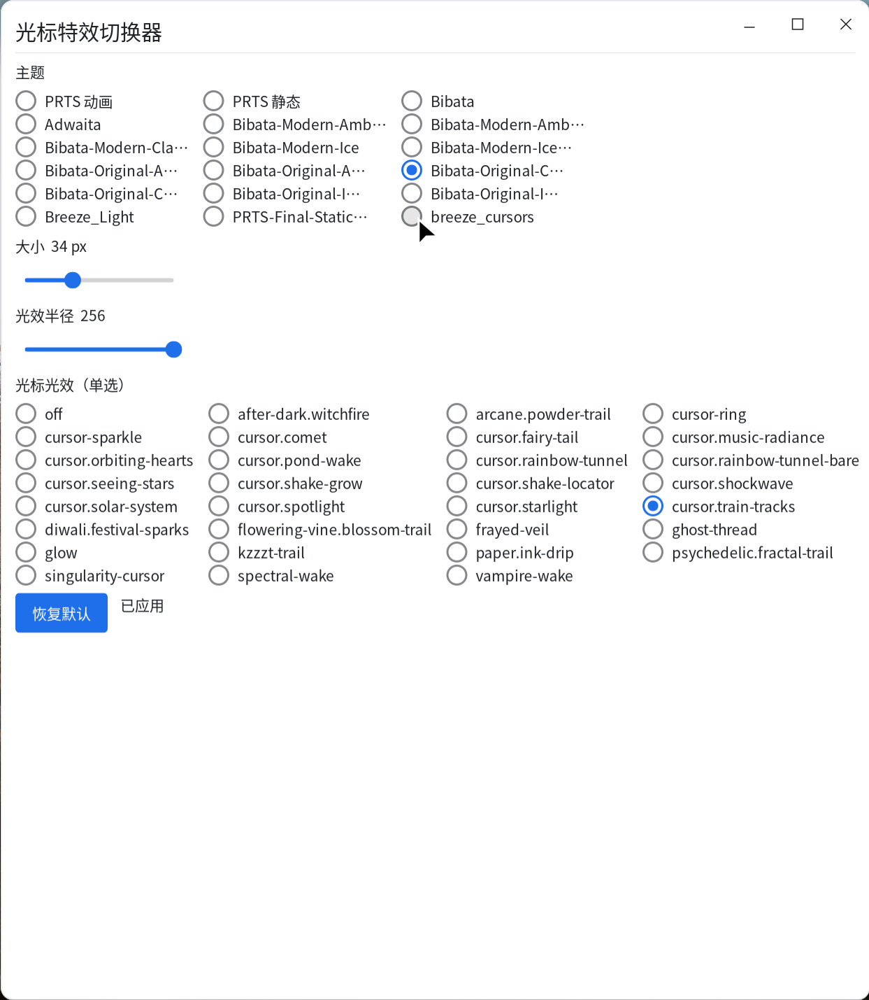

# Cursor Effects Switcher

[English](README.md) | [简体中文](README.zh-CN.md)

A cursor theme, size and shader-effect switcher for [Umbriel](https://github.com/noctalia-dev/umbriel), built with [HuxerUI](https://github.com/HuxerUI/HuxerUI).



## Features

- **Auto-detects** installed Xcursor themes (`~/.local/share/icons`, `~/.icons`, `/usr/share/icons`) — no hardcoded list
- Switches cursor theme and size (16–72 px)
- Auto-discovers community cursor shader effects (currently 30); newly installed effects appear automatically and are added to Umbriel's `[include]` when selected
- Adjustable effect radius
- Changes are written to `~/.config/umbriel/config.toml` and hot-reloaded immediately — no Apply button
- Chinese / English UI, switchable inside the app and remembered across restarts
- Floating window 640×700 (Umbriel window rule), custom title bar

> Only writes Umbriel configuration; effects are Umbriel shaders. Installed theme files are plain Xcursor and usable by any desktop, but switching is Umbriel-specific.

## Build

Requires the [HuxerUI SDK](https://github.com/HuxerUI/HuxerUI) 0.5.5+ and GTK 4 development packages:

```sh
curl -fsSL https://github.com/HuxerUI/HuxerUI/releases/latest/download/install.sh | sh -s -- --yes
export HUXERUI_HOME=$HOME/.local/share/HuxerUI
export PATH=$HUXERUI_HOME/bin:$PATH
huxerui build linux --config release
./scripts/stage.sh
./scripts/package-all.sh        # rpm + deb + AppImage
```

## Install

```sh
./install.sh      # installs to ~/.local/opt/cursor-switcher
```

Or use the RPM / DEB / AppImage from [Releases](https://github.com/h465855hgg/umbriel-cursor-switcher/releases).

## Notes

- Effects are single-select; Umbriel can only mount one cursor effect at a time
- Add new effects by dropping a shader directory into `~/.config/umbriel/shaders/community/cursor/<name>/`

## License

MIT
