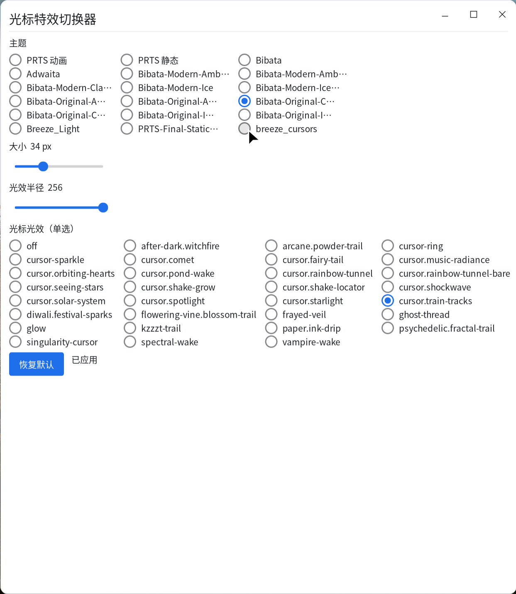

# 光标特效切换器

[English](README.md) | [简体中文](README.zh-CN.md)

给 [Umbriel](https://github.com/noctalia-dev/umbriel) 用的光标主题、大小与 shader 光效切换器，[HuxerUI](https://github.com/HuxerUI/HuxerUI) 编写。



## 功能

- **自动识别**已安装的 Xcursor 主题（扫 `~/.local/share/icons`、`~/.icons`、`/usr/share/icons`），没有写死列表
- 切换光标主题与大小（16–72 px）
- 自动发现社区光标 shader 光效（当前 30 个）；新装的效果会自动出现在列表里，选中时自动加进 Umbriel 的 `[include]`
- 可调光效半径
- 改动即时写入 `~/.config/umbriel/config.toml` 并热重载，没有「应用」按钮
- 中英文界面，可在软件内切换并记住上次选择
- 浮动窗口 640×700（Umbriel 窗口规则），自绘标题栏

> 只写 Umbriel 的配置；光效是 Umbriel 的 shader。主题文件本身是通用 Xcursor，其它桌面也能用，但切换只针对 Umbriel。

## 构建

需要 [HuxerUI SDK](https://github.com/HuxerUI/HuxerUI) 0.5.5+ 和 GTK 4 开发包：

```sh
curl -fsSL https://github.com/HuxerUI/HuxerUI/releases/latest/download/install.sh | sh -s -- --yes
export HUXERUI_HOME=$HOME/.local/share/HuxerUI
export PATH=$HUXERUI_HOME/bin:$PATH
huxerui build linux --config release
./scripts/stage.sh
./scripts/package-all.sh        # rpm + deb + AppImage
```

## 安装

```sh
./install.sh      # 装到 ~/.local/opt/cursor-switcher
```

或者用 [Releases](https://github.com/h465855hgg/umbriel-cursor-switcher/releases) 里的 RPM / DEB / AppImage。

## 说明

- 光效单选，Umbriel 同一时间只能挂一个
- 新效果放进 `~/.config/umbriel/shaders/community/cursor/<名字>/` 即可

## 许可

MIT
